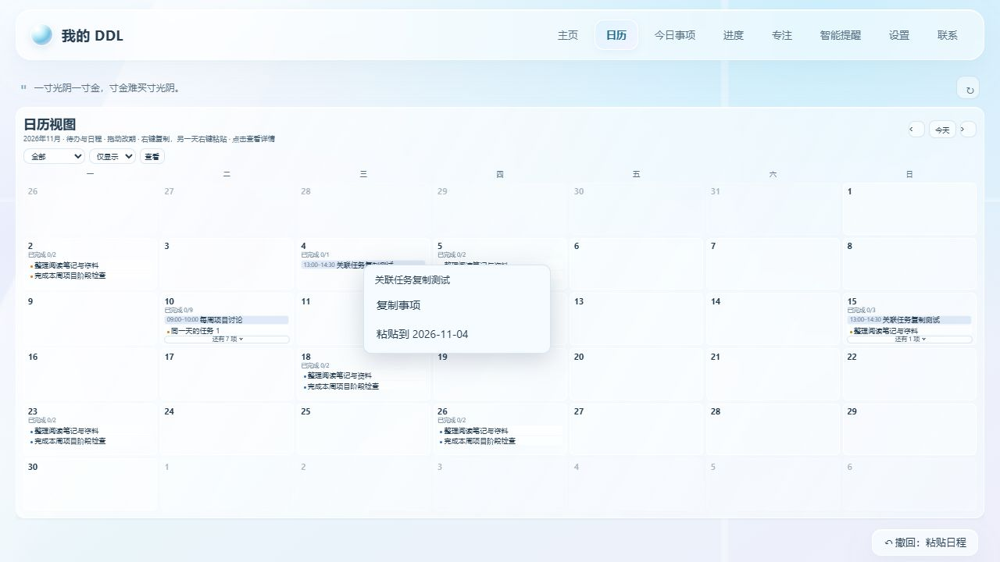

# v4.4.3 日历复制粘贴

右键日历中的事项，选择“复制事项”；再右键另一天，选择“粘贴到 YYYY-MM-DD”。可以先切换月份，也可以将同一复制内容粘贴到多个日期。未复制时，粘贴按钮不可用。

## 复制范围

保存复制时的标题、时间、类别和备注；之后编辑或删除原事项，不影响复制内容。粘贴生成一个独立、未完成的事项，保留原事项。子任务树、完成记录和重复规则不随单条事项复制。关联 DDL 的日程会创建新的关联任务，副本的编辑与完成不会改变原任务。

复制内容在当前窗口会话内保存，切换月份和刷新页面后仍可粘贴，按本机账号隔离。粘贴后可通过页面底部“撤回”移除副本。关联任务与日程整体创建，任一写入失败都回滚。

## 验证

- 158 项 Python 回归测试通过，新增 8 项覆盖完成子任务的独立副本、时间和备注、跨月及重复粘贴、快照与原事项独立、关联任务复制、账号隔离、无效输入、写入失败回滚和 HTTP 撤回。
- 浏览器实际验证普通 DDL 复制至另一天、原事项保留、撤回副本、关联日程从 10 月复制到 11 月，时间与备注保留。
- 验证未复制时禁用粘贴，以及窗口右下角菜单自动避让，不遮出页面边界；月历继续保持整月一屏。
- JavaScript 语法检查、192 组月历适配计算和专注前端回归通过。

所有检查使用隔离测试数据。
