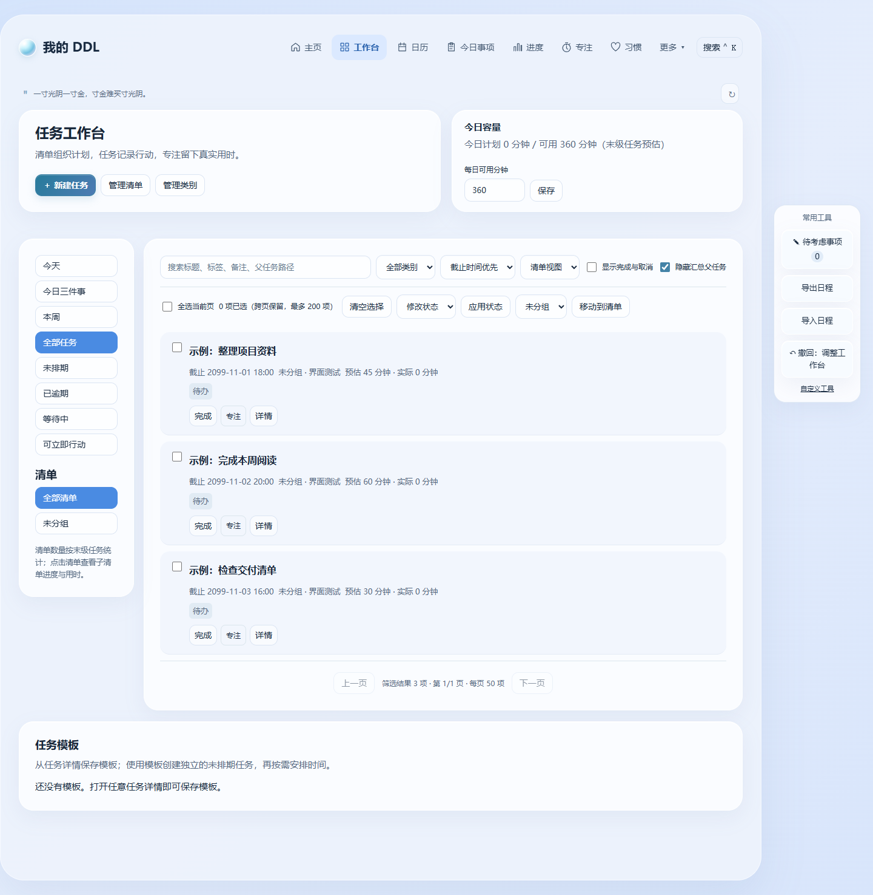
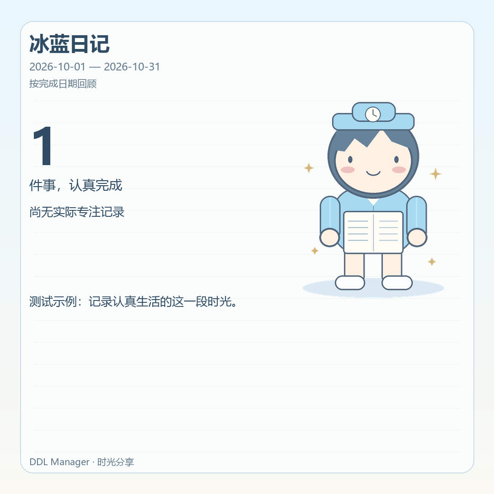
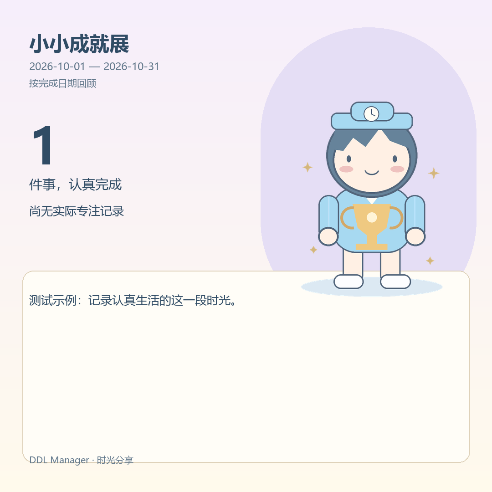
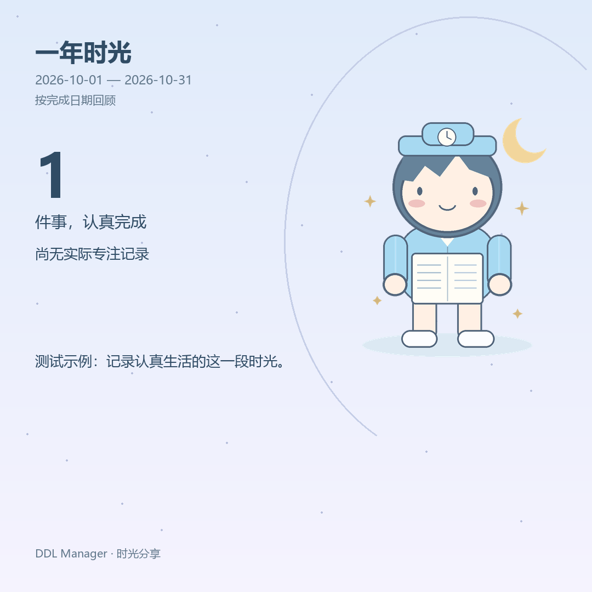

# DDL Manager 5.1.0 · 本轮实施记录

## 实际代码与入口

| 功能 | 代码 | 入口 |
|---|---|---|
| 前夜微信快照与本地后台 | daily_push.py、templates/daily-push.html、static/daily-push.js | 更多 → 微信每日推送 |
| 可选云端客户端 | cloud_push.py、static/cloud-push.js | 微信每日推送 → 云端连接 |
| Worker、D1 与部署说明 | cloud/daily-push/ | 自行部署，未上线 |
| 时光分享与三个人物九个姿态 | time_share.py、static/characters/、templates/time-share.html | 更多 → 时光分享 |
| 项目阶段模板、T 相对日期与成果周复盘 | project_review.py、templates/project-review.html | 更多 → 项目与周复盘 |
| OCR / 文字通知差异确认 | notification_updates.py、templates/notification-updates.html | 更多 → 通知更新建议 |
| 全视图主题筛选 | calendar_themes.py、planner.py、static/calendar-theme.js | 日历的类别 / 清单 / 标签筛选 |
| 参考图视觉统一 | static/soft-blue.css、static/soft-blue.js | 冰蓝琉璃主题 |

源代码位于 D:/ddl-app。不是 Git checkout；改动前源码副本保存在 `.cache/pre-next-update`。未重建原有任务或同步数据库。

## 迁移与回退

新增独立表：daily_push_config、daily_push_snapshots、daily_push_dirty、daily_push_build_state、daily_push_cloud、time_share_drafts、project_blueprints、project_previews、weekly_reviews、notification_proposals、recurrence_instance_originals。表通过 CREATE IF NOT EXISTS 增量建立。推送脏版本由账号隔离的触发器维护，空闲时不重复重建草稿。

旧任务 UUID、清单、日程、专注、习惯及附件不重建。新表随现有 SQLite 完整备份保存；项目模板、项目生成、通知更新和复盘文字接入现有撤回记录。推送发送状态不受全局撤回影响，以免撤回导致重复推送。

正常桌面启动沿用升级前完整备份。回退须先完全退出，再使用升级前的完整备份与旧程序文件；不要只删除新表，尤其通知更新的单次重复例外与后续系列相关。DPAPI 凭据绑定 Windows 用户，换电脑应重新配置。新扩展内容不加入原有任务交换文件；完整迁移使用完整备份。

## 微信行为

前一天首次检查或数据变动后生成次日草稿，正文只含标题、项目路径、时间及必要状态。关联任务按稳定 ID 合并，多个执行时段保留；同名不同 ID 保持独立。手动保存锁定，自动更新不能覆盖。默认 23:59 冻结；晚于前夜才恢复运行的旧草稿明确跳过，不声称最终版。冻结版本不受次日任务编辑影响。

本地发送读冻结正文；服务受理、拒绝、超时未知分别展示。发送前持久领取，未知结果不自动重试。补发窗口可配置；软件需要在后台运行。正常退出前再保存一次当前草稿。

云端默认未配置。明确选择云端方式后，冻结时自动提交；已成功提交的消息由 Worker 独立发送。本机无响应显示 unknown，查询或撤销后再修改设置，不自动切换本地。云端部署及真实微信接收仍待用户自行授权配置，详见 `cloud/daily-push/README.md`。

## 分享与素材

周（周一开始）、月、年、自定义范围；按完成日期或截止日期；类别、清单（包含子清单）及标签过滤。排除取消事项及汇总父任务；重复实例按稳定 ID 记录。无截止时间的完成项不计准时率，专注按结束日期归属，多任务按分配秒数计入。

三套构图：冰蓝日记、小小成就展、一年时光。三个原创人物：小时、小满、小月；每人计划本、奖杯和时光书场景。源码插画与透明 PNG 一并保存，来源说明见 `static/characters/ORIGIN.md`。

PNG 支持 1080×1920、1080×1080、1200×630。本机实时预览、草稿保存、下载、浏览器图片剪贴板及 Windows 原生 DIB 回退；系统分享仅在浏览器能力可用时显示。默认不展示昵称、任务名称、项目名称、逾期详情和总结；任务名称必须另行勾选具体任务。长文案按可用行数省略，界面明确提示各尺寸代表成果数量上限。

测试样张位于 `.cache/time-share-examples`，其中内容是隔离测试数据，不是用户的真实成绩。图中“测试示例”明确标识。新旧界面截图位于 `.cache/next-ui`，before-theme 是同一隔离页面关闭新增主题层的对照。

## 统计与一致性

工作台实际工时改为复用专注历史的整数秒分配，排除休息和已回收记录，避免各页面四舍五入不一致。旧进度页统计排除汇总父任务与取消项。完成率分母为选定截止月份的有效事项；准时率分母为已完成事项；效率评分仍为完成率 × 70% + 按时完成数 / 总数 × 30%。分享的完成日期口径单独标注，绝不把创建至完成的历时当作实际投入。

既有首页和工作台详情路径保留，今日 DDL 增加统一详情入口；旧快捷编辑仍保留兼容。通知更新需要明确选定已有 UUID，展示前后字段并检查版本；单次修改保留原重复规则供后续生成，系列修改只影响当前及后续未完成实例。已完成历史不覆写。

## 设计来源与工具

视觉方向采用用户给定参考：冰蓝外层、白卡片、柔和阴影、深色中文正文、蓝色图形与统一线性图标。字体使用 Windows 本地 Segoe UI / 微软雅黑，不引入在线字体或重型前端依赖。紧凑模式与字体放大按本机账号保存。

检查了当前技能目录；imagegen 可用并已阅读说明，本次采用可复用代码绘制人物，因此没有调用付费图像接口。未安装的第三方技能不伪称已调用。已查阅官方 frontend-design、canvas-design、web-design-guidelines 内容，及 ui-ux-pro-max 项目资料：Anthropic 两项技能许可为 Apache-2.0，ui-ux-pro-max 为 MIT；Vercel 仓库根 LICENSE URL 未找到，不据此引入或重新分发其代码。使用的是原创 CSS、图标路径与插画代码。参考仓库：anthropics/skills、nextlevelbuilder/ui-ux-pro-max-skill、vercel-labs/agent-skills。

## 验证与外部边界

- 项目虚拟环境完整回归 268 项通过（51.487 秒），日志 `.cache/next-final-tests.log`；桌面传输修复后另行验证 5 项通过。
- Worker 内存 SQLite 模拟通过，不发真实消息。
- 月历 192 种尺寸/周数组合、专注时钟及 600 种布局检查通过。
- Windows Edge 无界面实测工作台、微信推送、时光分享、项目周复盘、通知更新、月历、周历、习惯和专注页面，无脚本异常；900 / 1366 像素宽度检查无横向溢出；PNG 预览实际尺寸核实为 1080×1920。
- 时光分享测试覆盖三模板×三尺寸、中文长标题、空数据、时间边界、账号隔离、隐私默认与确定性输出。
- 尚未进行真实 Cloudflare 部署、真实 SendKey 发送、物理多显示器或全部系统 DPI 组合验收；这些不能用本地模拟替代。系统分享能力依运行环境决定。

## 最终桌面验收与交付

实际 EXE 在移除外部 Python 路径、禁止 Python TCP 连接与监听的环境中完成新装注册、重启已有账号与日程、三层任务显示以及打包的离线 OCR 验证。发现并修复关闭窗口时未完成 WebView2 请求的 deferral 回调异常；修复后的实际程序退出码为 0。证据在 `.cache/next-package-smoke.log` 和 `.cache/serverless-package-da1495d605cf47109483c8d984091068/package-test.json`。

Edge 模拟 125%、150%、200% device scale，结合 1024×768、大字体、紧凑模式、高对比度和减少动画，对工作台、日历、专注和分享共 12 组页面检查通过。此项是浏览器设备缩放模拟，不等同于真实多显示器验证。月历展开按钮也修正为适配行高，避免被全局按钮最小高度覆盖。

构建命令：`.venv/Scripts/python.exe -m PyInstaller --noconfirm --workpath build/next-work --distpath build/next-package DDLManager.spec`。随后 `build_installer.ps1 -NextBuild` 从隔离构建目录制包；不从已使用的安装目录取文件。便携包检查禁止用户数据库、日志、密钥及缓存，包含本机原创插画和 tzdata。Windows 安装器沿用既有用户级安装方案，并捆绑经过签名校验的 Microsoft WebView2 离线安装器。完整卸载 / 安装操作尚未在用户真实安装目录执行。

桌面版本通过 GitHub Release 发布；没有配置或发送真实微信消息，没有部署云端。原有快捷编辑入口保留兼容，未全部重写成单一编辑组件；当前扩展没有加入跨设备任务交换格式。正常任务与完整备份回归通过，但任意历史版本、物理多显示器、真实服务额度和网络环境仍不能仅由本地测试保证。

## 截图与导出索引

- 主题前后：`.cache/next-ui/workspace-before-theme.png`、`.cache/next-ui/workspace.png`。
- 核心页面：`.cache/next-ui/calendar.png`、`focus.png`、`habits.png`、`daily-push.png`、`time-share.png`。
- 三个模板：`.cache/time-share-examples/diary-square.png`、`gallery-square.png`、`yearbook-square.png`；同目录包含每套的 portrait、square、landscape 三种实际导出。
- 三位人物和九个正式动作：`static/characters/`；代码来源与使用说明在 `ORIGIN.md`。

样张使用明确标识的测试数据。真实使用时从“更多 → 时光分享”选择时期、过滤范围和隐私字段，确认预览后导出。

## v5.1.0 发布预览

以下海报为明确标注的测试示例，不是用户的真实成绩。

