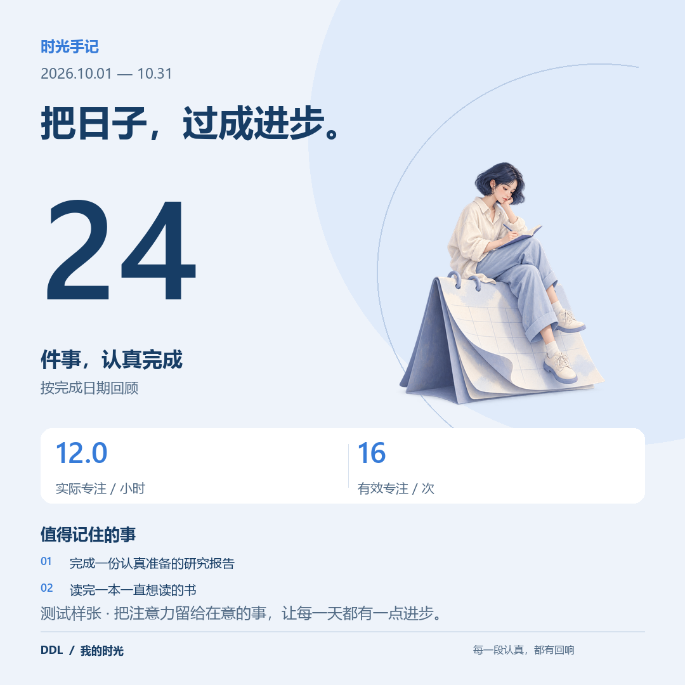
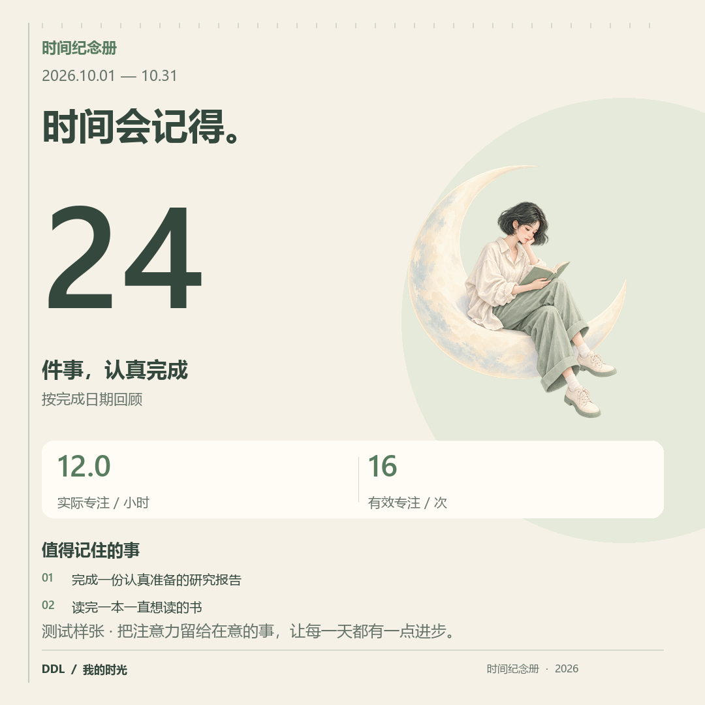
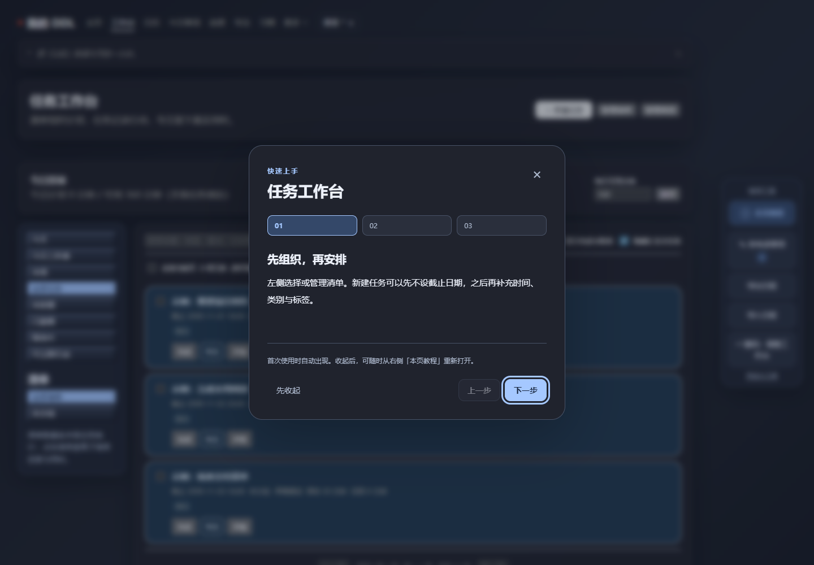

# v5.1.1 · 分享设计、首次教程与皮肤适配

## 分享 PNG 与工作室

三套版式采用大数字、清晰的信息层级、留白和原创水彩人物。参考 [Spotify Wrapped 的年度总结分享](https://newsroom.spotify.com/media-kit/2024-wrapped/) 与 [Strava 年度回顾](https://contentful-assets.strava.com/Strava-Year-In-Sport-Trend-Report-2025-US.pdf) 的信息组织思路，未使用其品牌素材。

- 冰蓝手记：浅蓝纸感与深蓝字，轻盈清晰。
- 成就展：深蓝背景与黄绿数字卡，突出完成成果。
- 时间纪念册：奶油纸色、鼠尾草绿、刻度细节；竖版先展示足迹再展示专注。
- 三位原创人物、三种输出尺寸：1080×1920、1080×1080、1200×630。
- 数字来自真实记录，不用任务存在时长代替专注。无记录时明确显示空状态。
- 默认隐藏任务名称；只展示用户选中且明确开启名称的成果。可控制昵称、项目、统计、专注、逾期、总结与品牌。
- 设置分为时间范围、画面样式、隐私文案、代表性成果；右侧直接预览实际 PNG，支持保存、复制、系统分享与草稿读写。

以下示例来自隔离测试数据库中的 24 项完成记录与 16 次、共 12 小时的专注，均明确标注“测试样张”。

## 首次教程

覆盖 23 个功能页，以及日、周、年、议程、甘特 5 个独立规划视图，共 28 个入口。每页三步，内容针对该页面的实际操作。首次进入自动出现，支持下一步、上一步、步骤跳转、跳过、关闭和 Esc。关闭后保留右侧“本页教程”按钮。

状态按本机账号和页面分别记录在设置中，刷新和重启后不重复打扰。右侧教程入口不受其他工具显隐设置影响。登录、注册和悬浮小窗不属于全功能页面。

## 皮肤适配

冰蓝、纸感、雾蓝、薄荷、玫瑰、夜间、纯净、蓝色、绿色九套皮肤分别适配工具栏、清单栏及教程的底色、文字、边框、选中、悬停和键盘焦点。夜间模式同时适配工具栏打开的待考虑、导入导出和搜索面板；高对比度模式提供额外颜色覆盖。

## 验证

- 272 项 Python 回归测试通过；新增教程的账号隔离、页面隔离、跨实例记忆、CSRF 校验及海报隐私回归。
- 浏览器验证首次出现、关闭、刷新后不再出现、清空浏览器缓存后仍保持服务器记录、手动重开。
- 九套皮肤的左右侧栏普通按钮文字对比度均至少 4.5:1；验证键盘关闭、选中态和截图。
- 分享模板选择、方形 PNG 实际尺寸、保存/读取草稿、900/1100/1440 宽度无横向溢出、无页面脚本错误。
- 使用隔离真实记录生成九张模板与尺寸组合样张，检查主要版式。

升级仅替换程序文件，保留 data。教程设置使用现有设置表，无新增破坏性数据库迁移。
