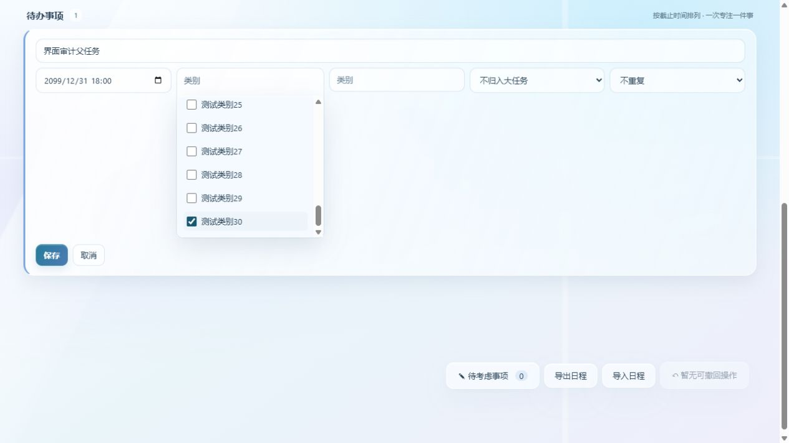
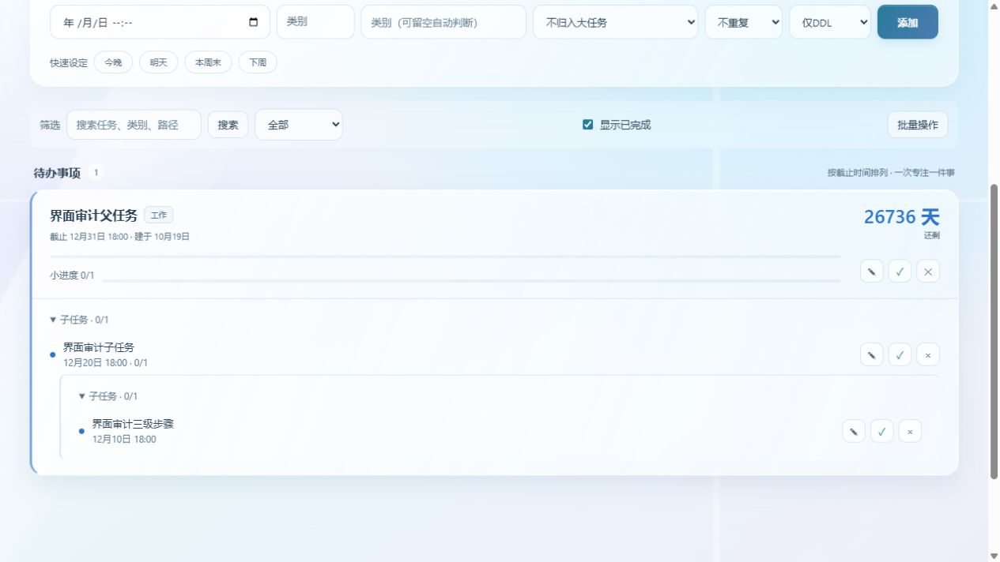

# DDL Manager 用户反馈修复与测试记录

更新日期：2026 年 10 月 19 日。版本：v4.4.1。包含当前修复及对应安装包、便携包的发布说明。

首轮审查确认的 9 项问题已完成源码修复和验证。父子任务、已完成列表与多级展示使用统一树结构；完成和重新打开按层级联动，关联日程的编辑与状态更新保持一致。原先 7 项预期失败用例已转为普通测试并全部通过。

本次同时加入任务折叠、主页搜索和已完成显示开关。年历、多级清单容器、类别管理及任务专注联动等新增需求仍单独列在后续清单，未计入“已修复”。

## 原有问题修复状态

| 编号 | 原问题 | 修复后的行为 | 验证 |
| --- | --- | --- | --- |
| FB01 | 完成父任务后子孙仍未完成 | 在一次事务内完成当前任务及所有后代；保留原先已完成子任务的历史时间 | 自动化、浏览器整组完成 |
| FB02 | 全部子任务完成后父任务不自动完 | 检查兄弟完成状态并逐级向上完成；重新打开子任务时重新打开祖先 | 自动化、关联日程入口 |
| FB03 | 已完成任务平铺且父子分散 | 按父子树展示，支持逐级展开；已完成子任务保留在未完成大任务下，避免重复归档 | 自动化、浏览器三级归档 |
| FB04 | 三级任务中的孙任务未展示 | 所有层级统一构建任务树并递归渲染；创建及编辑可选择中间层父任务 | 自动化、浏览器编辑第三级 |
| FB05 | 分类筛选遗漏跨类别子任务 | 命中子任务时保留必要的祖先路径；完成与未完成任务使用相同筛选规则 | 自动化、搜索定位 |
| FB06 | 中间层可提前到其子任务之前 | 每一层均校验直属子任务截止时间；关联日程编辑和日历拖动同样校验 | 自动化、非法修改整体回滚 |
| FB07 | 任务改名后日历仍显示旧名称 | 编辑时同步关联计划的标题、分类和日期；日历及今日事项还会从原任务读取元数据，兼容旧副本 | 自动化、旧副本模拟 |
| FB08 | 编辑分类菜单被卡片裁切 | 编辑菜单在布局内展开且独立滚动；复选框不再被普通输入框的布局规则拉伸 | 浏览器实际选择第 35 个类别 |
| FB09 | 右下工具遮挡子任务按钮 | 待考虑事项、导入、导出和撤回改为页面底部工具区，不覆盖任务内容 | 浏览器 1280×720 与 390×844 |

重新打开父任务时保留子任务原有完成状态；重新打开某个子任务时，只重新打开该项及祖先，不清除其他兄弟任务的完成记录。

截止时间和实际完成时间分开处理：子任务的截止时间不能晚于直属父任务；级联完成时，各子任务的准时或逾期状态按自己的截止时间计算，不照搬父任务的手动标记。

## 额外发现并处理的边界问题

- **关联日程只保存一半。** 原流程先提交日程再校验任务，任务校验失败时日程已改变。现在任务校验、任务更新和关联日程更新放在同一事务，失败后全部回滚。
- **筛选使用过期副本。** 日历原先只从已按月份和类别过滤的任务中寻找关联，可能回退到旧标题、旧类别或旧完成状态。现在独立解析账号内的关联任务，再应用展示筛选。
- **重复生成下一轮。** 完成操作先捕获本轮后代，再生成重复事项的下一轮；并发完成和重复提交只生成一次。父任务已完成时，下一轮子任务作为独立未完成任务保留，不被本次完成波及。
- **操作不能整组撤回。** 完成、关联计划状态和本次生成的重复事项一起纳入已有撤回快照；回归确认可恢复原有记录。
- **错误的父任务选项。** 编辑时排除自己和后代；用路径及编号区分同名项。旧数据中父任务已完成但子任务未完成的关联仍保持选中，避免编辑后意外解除关系。
- **旧数据循环或失效关联。** 祖先遍历增加循环保护；畸形循环在主页作为根项展示，避免无限循环和条目消失，不自动重写用户数据。跨账号或失效日程关联按独立日程处理完成操作，不改动其他账号任务。
- **嵌套事务兼容。** 复用 Dot 桥接已经开启的事务，保留原有请求幂等、校验与整次撤回逻辑。

## 已实现的主页体验改进

| 功能 | 当前行为 |
| --- | --- |
| 父任务展开收起 | 每层可折叠，保留完成数量；刷新及局部更新后恢复本机账号偏好 |
| 主页搜索 | 按任务标题、类别和所属路径查找未完成与已完成 DDL 任务，同时查找未完成独立日程；命中深层任务时展开其祖先 |
| 已完成隐藏开关 | 控制已完成区域，按本机账号记忆；不改变完成记录和统计 |
| 同名任务识别 | 父任务选项显示路径与编号，关联仍以 ID 处理 |
| 工具区避让 | 使用页面底部普通布局；保留原导入导出及撤回功能 |

显示偏好存于本机浏览器存储，不属于跨电脑日程导出内容。专注记录、作品及业务数据结构本次未迁移。

## 测试结果

- 全部 Python 回归：**150 项通过，无失败，无预期失败项**。其中原有 118 项，专项反馈用例 32 项。
- 前端语法检查：`node --check static/app.js` 通过。
- 专注前端回归：`node tests/test_focus_frontend.js` 通过，覆盖计时、600 种拼图布局、20 种植物、作品记录入口及跨窗口令牌恢复。
- 浏览器检查：1280×720 下完整选择最后一个分类、三级任务编辑、折叠状态刷新保持、搜索命中深层任务、整组完成后三级归档、隐藏已完成刷新保持、整组撤回恢复。390×844 下第三级任务仍可编辑，未出现横向溢出；测试后已恢复默认视口。
- 事务测试：级联过程中模拟失败后数据库整体回滚；非法关联日程编辑不改变任一行；多线程完成同一父任务只生成一个重复事项后续。
- 数据隔离测试：全部使用临时数据库，未修改现有用户数据库；同名任务导入、分类持久化、账号隔离、旧失效关联、普通任务删除后日历清除均通过。

Python 使用项目已有 `.venv`。系统 Python 首次审查时缺少 rapidocr，不能作为最终测试环境；本次没有安装或升级依赖。

### 复现和回归命令

```powershell
.\.venv\Scripts\python.exe -m unittest discover -s tests -p test_user_feedback.py -v
.\.venv\Scripts\python.exe -m unittest discover -s tests -v
node --check static/app.js
node tests/test_focus_frontend.js
# 可选：启动隔离界面服务，结束后 Ctrl+C
.\.venv\Scripts\python.exe tests/feedback_ui_server.py
```

用例位于 `tests/test_user_feedback.py`；完整测试日志为 `.cache/feedback-fix-tests.log`。界面夹具仅监听 `127.0.0.1:5137`，数据库位于 `.cache/feedback-ui-*`，导入 app 前先切换到该隔离目录。

## 修复后截图

分类列表可以滚动到底并实际选择最后一项：



任务按三级结构展示，操作按钮不被工具覆盖：



完成父任务后整组保留父子关系：


首轮问题截图仍保存在 `.cache/feedback-evidence/category-clipping.jpg` 和 `toolbar-overlap.jpg`，可用于对比。截图属于本地测试产物，清理缓存前应保留所需证据。

## 仍需证据的问题

| 用户反馈 | 当前结论 | 后续验证所需 |
| --- | --- | --- |
| 丢档和数字串替代任务名 | 尚未复现，不能宣称已修复或断定是数据库损坏 | 脱敏样本、出问题的软件版本及具体操作顺序；对比同步前后的数据库与文件 |
| 真实同步失败 | 本地文件导入与同步模块的自动化测试通过，未使用真实微软账号做在线验证 | 区分手动文件导入与 Microsoft To Do，同步失败日志、中断重试及升级场景 |
| 任务清零后日历残留 | 普通任务删除路径通过；已完成历史保留属于现有设计 | 核对残留条目是否为独立日程、重复事项的新一轮或旧版本数据 |
| 邮件截图细节 | 首轮尝试访问附件失败 | 本次修复判断依据为本地复现与截图，没有把原邮件附件当作已查看证据 |
| 原生安装与系统场景 | 发布提供新的安装包和便携包；系统缩放、休眠恢复和原目录安装尚未完整验收 | 后续补测系统缩放、休眠恢复和原目录安装升级 |

## 新增需求与后续修改建议

以下需求仍未实现，不属于本轮 9 项缺陷修复的完成范围。

| 范围 | 修改建议 | 优先级 |
| --- | --- | --- |
| 类别管理 | 显式新建、改名、合并、删除；删除类别时迁移引用，不删除任务 | P2 |
| 数据入口 | 导入导出迁入设置的数据管理，主页保留必要快捷入口 | P2 |
| 清单分组 | 新增无强制截止日期的独立多级清单容器，显示完成数与用时明细 | P3 |
| 悬浮窗范围 | 可选今日、近期、全部及仅可执行任务；允许隐藏汇总父任务 | P2 |
| 日历密度 | 紧凑、标准和宽松密度，适应窗口查看整月 | P2 |
| 日周年视图 | 复用今日时间轴，补齐周视图及年历，并与筛选和统计口径统一 | P3 |
| 图片导出 | 导出仪表盘及年历，附时间范围和统计口径 | P3 |
| 纯净计时 | 不创建作品也能直接正计时或倒计时；作品作为可选激励 | P2 |
| 任务专注联动 | 任务卡和悬浮窗携带任务 ID 直接计时；支持多任务关联及结束后补记 | P2 |
| 专注日历 | 对应任务下显示专注时段和用时，可自行关闭展示 | P2 |
| 作品整理 | 改名、分组、归档、删除；专注历史应独立保留 | P2 |
| 习惯与教程 | 单独规划习惯版块，解释任务、计时记录与作品的关系 | P3 |

后续应保持任务、清单、计时记录和作品职责清晰；按稳定 ID 关联。一段专注关联多个任务时，总用时只累计一次；清单完成数量应明确按叶子任务还是全部节点计算，避免父子重复计数。
